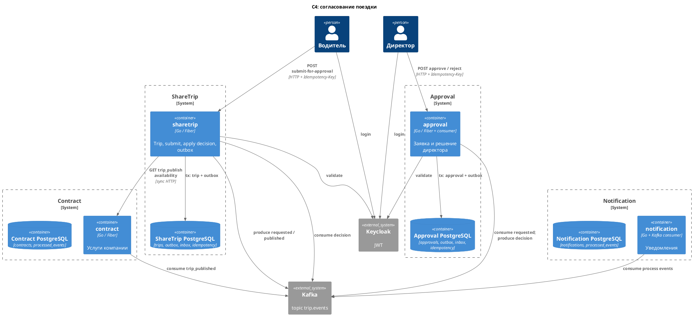
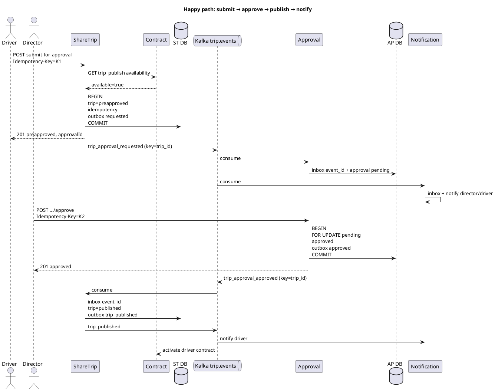
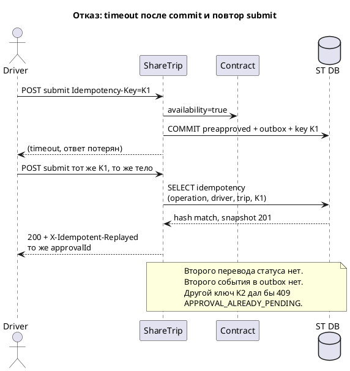

# Согласование поездки: design

Документ описывает целевой процесс согласования черновика поездки директором. Сейчас решение живёт в ShareTrip (`PUT /api/trip/approve`). Здесь approval выделен в отдельный сервис: он владеет заявкой на согласование и решением, ShareTrip владеет поездкой, Contract — правом публиковать, Notification — доставкой уведомлений.

Пишущие HTTP-контракты: [`api/operations/`](../api/operations/).

- [submit-trip-for-approval.yaml](../api/operations/submit-trip-for-approval.yaml)
- [approve-trip-approval.yaml](../api/operations/approve-trip-approval.yaml)
- [reject-trip-approval.yaml](../api/operations/reject-trip-approval.yaml)

Topic Kafka: `trip.events` (env `KAFKA_TRIP_EVENTS_TOPIC`, в k8s сейчас `trip-events`). Ключ партиции для событий процесса — `trip_id`.

---

## 1. Цель пользователя и happy path

**Цель водителя:** отправить черновик на согласование и получить опубликованную поездку, которую видят пассажиры.

**Цель директора:** принять или отклонить заявку. Одобрение публикует поездку. Отклонение возвращает её в черновик.

**Цель пассажира в этом процессе:** не участвует в решении. После публикации получает уведомление, если воркер матчинга найдёт его заявку. Водитель получает уведомления о приёме на согласование, публикации и отклонении.

### Happy path

1. Водитель уже создал поездку (`draft`). Клиент генерирует `Idempotency-Key` и вызывает `POST /api/trips/{tripId}/submit-for-approval`.
2. ShareTrip синхронно спрашивает Contract: доступна ли компании услуга `trip_publish`.
3. Если да, в одной транзакции ShareTrip:
   - переводит поездку `draft → preapproved`;
   - пишет history;
   - сохраняет запись идемпотентности;
   - кладёт в outbox событие `trip_approval_requested`.
4. HTTP отвечает `201` с `approvalId` (детерминированный UUID заявки, см. §6) и статусами `preapproved` / `pending`.
5. Outbox publisher отправляет событие в Kafka.
6. Approval по `event_id` создаёт заявку `pending`, если активной ещё нет.
7. Notification по тому же событию создаёт уведомление директору (и водителю — «отправлено на согласование»).
8. Директор вызывает `POST /api/approvals/{approvalId}/approve` со своим `Idempotency-Key`.
9. Approval в одной транзакции:
   - блокирует заявку `FOR UPDATE`;
   - ставит `approved`;
   - пишет outbox `trip_approval_approved`.
10. HTTP отвечает `201`. Поездка в этот момент ещё `preapproved`.
11. ShareTrip обрабатывает `trip_approval_approved`: `preapproved → published`, outbox `trip_published`.
12. Contracts по `trip_published` активирует контракт водителя (`draft → active`).
13. Notification по `trip_published` уведомляет водителя: поездка опубликована.
14. Воркер ShareTrip при наличии свободных мест может позже эмитить `trip_publish_notificated` пассажирам с совпадающим маршрутом.

Отклонение вместо шагов 8–13: `reject` → `trip_approval_rejected` → ShareTrip возвращает поездку в `draft` → Notification уведомляет водителя.

```text
draft  --submit-->  preapproved  --approve-->  published
                         |
                         +--reject-->  draft
```

---

## 2. Участники и ответственность

| Сервис | Владеет | Решения |
|---|---|---|
| **sharetrip** | агрегат `Trip`; статусы поездки; history; outbox своих событий; HTTP отправки на согласование; применение решения к поездке | поездка в `draft`? водитель — владелец? можно ли менять статус после решения approval |
| **contract** | договоры компании и водителя; флаги услуг (`trip_publish`, `trip_start`); статусы контракта `draft/active/suspended/terminated` | разрешена ли услуга компании **сейчас** |
| **approval** | агрегат `Approval` (заявка на согласование); решение `pending/approved/rejected`; кто решил и когда; свой outbox | принять или отклонить **эту** заявку; есть ли уже активная заявка на поездку |
| **notification** | `notifications`; inbox `processed_events` | **не принимает бизнес-решений**. Только кому и какой тип уведомления по `event_type` |

ShareTrip **не** хранит комментарий директора и не считает заявку источником истины по решению. Approval **не** меняет `trips.status` напрямую. Contract **не** знает о заявках. Notification **не** ретраит публикацию поездки.

Данные по сервисам:

**sharetrip:** `trips`, `trip_status_history`, `outbox_events`, `idempotency_keys` (свои команды), таблица применения решений (inbox).

**contract:** `contracts`, `contract_services`, inbox `processed_events`.

**approval:** `approvals`, `approval_decisions`, `outbox_events`, `idempotency_keys`, inbox `processed_events`.

**notification:** `notifications`, `processed_events`.

---

## 3. Состояния, переходы, инварианты

### 3.1 Поездка

| Статус | Смысл в процессе согласования |
|---|---|
| `draft` | черновик, можно отправить на согласование |
| `preapproved` | ожидает решения approval; пассажирам не видна |
| `published` | директор одобрил, поездка в поиске |
| `started` / `completed` / `canceled` | вне процесса согласования |

Разрешённые переходы процесса:

| Из | В | Команда / событие | Предусловия | Постусловия |
|---|---|---|---|---|
| `draft` | `preapproved` | HTTP submit | владелец; Contract `trip_publish=allowed`; нет активной заявки | есть ровно одна `pending` заявка; outbox `trip_approval_requested` |
| `preapproved` | `published` | событие `trip_approval_approved` | заявка той же поездки в `approved`; consumer ShareTrip | outbox `trip_published`; активной заявки нет |
| `preapproved` | `draft` | событие `trip_approval_rejected` | заявка в `rejected` | водитель снова может править черновик и отправить заново |
| `preapproved` | `canceled` | HTTP cancel поездки | владелец; не `started` | заявка `pending` компенсируется в `cancelled` событием `trip_canceled` |

Инварианты поездки:

1. Пассажир видит поездку только в `published` (или если к ней уже прикреплена его заявка).
2. Пока статус `preapproved`, существует не больше одной заявки approval в `pending`.
3. `published` появляется только как следствие `approved`, не из HTTP директора в ShareTrip.
4. Стартовавшую поездку согласование не трогает.

### 3.2 Заявка на согласование (Approval)

Не путать с пассажирской `trip_requests`.

| Статус | Смысл |
|---|---|
| `pending` | ждёт директора |
| `approved` | решение зафиксировано, публикация ещё может догонять |
| `rejected` | отклонена |
| `cancelled` | поездку отменили, пока заявка была `pending` |

| Из | В | Кто | Предусловия | Постусловия |
|---|---|---|---|---|
| — | `pending` | consumer `trip_approval_requested` или синхронно при submit, см. §14 | нет другой `pending` по `trip_id` | `approval_id` стабилен |
| `pending` | `approved` | HTTP approve | директор; `FOR UPDATE`; статус всё ещё `pending` | outbox `trip_approval_approved`; повтор approve идемпотентен |
| `pending` | `rejected` | HTTP reject | то же + обязательный `reason` | outbox `trip_approval_rejected` |
| `pending` | `cancelled` | consumer `trip_canceled` | заявка ещё `pending` | решения директора больше нет |
| `approved` / `rejected` | * | — | терминальные | любые новые decide → `409` |

Инварианты заявки:

1. `UNIQUE (trip_id) WHERE status = 'pending'` — не две активные заявки на одну поездку.
2. Решение одно: `approved` и `rejected` взаимоисключающие.
3. `decided_at` и `decided_by` заполняются только при переходе из `pending`.
4. `correlation_id` заявки равен `correlation_id` исходного submit и копируется в последующие события. Он **не** ключ идемпотентности.

### 3.3 Гонка approve и reject

Два директора (или две вкладки, или две реплики) одновременно вызывают approve и reject по одной `approval_id`.

1. Оба HTTP попадают на любые реплики approval.
2. Транзакции делают `SELECT ... FROM approvals WHERE id = $1 FOR UPDATE`.
3. Побеждает тот, кто первый получил замок и увидел `pending`.
4. Он меняет статус, пишет outbox, коммитит.
5. Второй после ожидания видит терминальный статус и отвечает `409 APPROVAL_ALREADY_APPROVED` или `APPROVAL_ALREADY_REJECTED`.
6. В Kafka уходит **одно** решение. Ключ `trip_id` сохраняет порядок применения в ShareTrip.

Нельзя полагаться на «кто первый отправил в Kafka»: источник истины — строка `approvals` под блокировкой, не offset.

Если клиент повторяет **тот же** decide с тем же ключом и телом после успеха — `200` из идемпотентного хранилища, без второй записи в outbox.

Optimistic locking (`version`) допустим как дополнение: `UPDATE ... WHERE version = $n` → 0 rows трактовать как конфликт и перечитать статус. Для двух реплик достаточно `FOR UPDATE`.

---

## 4. Синхронные и асинхронные взаимодействия

| Взаимодействие | Тип | Команда или событие | Почему так |
|---|---|---|---|
| Клиент → ShareTrip submit | синхронный HTTP | **команда** | водитель должен сразу узнать, принят ли черновик и доступен ли `trip_publish` |
| ShareTrip → Contract availability | синхронный HTTP GET | **запрос** (не команда) | решение «можно ли отправлять» обязано быть до смены статуса; повтор чтения безопасен |
| ShareTrip → Kafka `trip_approval_requested` | асинхронно, outbox | **событие** | факт «черновик отправлен»; approval и notification подписываются независимо |
| Kafka → Approval | асинхронный consumer | **событие** | создание заявки не часть инварианта HTTP, если заявка создаётся из события; альтернатива — sync, см. §14 |
| Клиент → Approval approve/reject | синхронный HTTP | **команда** | директор должен получить принятое решение, даже если поездка ещё не опубликована |
| Approval → Kafka `trip_approval_approved/rejected` | асинхронно, outbox | **событие** | публикация поездки — другой агрегат и другая БД |
| Kafka → ShareTrip apply | асинхронный consumer | **событие** | ShareTrip применяет чужое решение к своему агрегату; падение ShareTrip не откатывает решение |
| Kafka → Notification | асинхронный consumer | **событие** | уведомление не инвариант поездки |
| Kafka → Contract (`trip_published`) | асинхронный consumer | **событие** | активация контракта водителя после публикации |

Команда меняет состояние адресата по требованию инициатора и ждёт ответ. Событие сообщает о уже случившемся факте; подписчики сами решают, что делать. Contract availability — запрос: он ничего не меняет.

ShareTrip **не** вызывает Approval синхронно на decide: иначе директор зависел бы от доступности ShareTrip в момент кнопки. ShareTrip **не** публикует поездку внутри HTTP approve: иначе Approval владел бы чужим агрегатом или появилась бы распределённая транзакция.

---

## 5. HTTP-контракты пишущих операций

Полные схемы request/response, заголовок `Idempotency-Key`, 2xx и ошибки — в YAML:

| Операция | Файл |
|---|---|
| Отправка черновика | `api/operations/submit-trip-for-approval.yaml` |
| Одобрение | `api/operations/approve-trip-approval.yaml` |
| Отклонение | `api/operations/reject-trip-approval.yaml` |

Общие правила:

- `Idempotency-Key` обязателен, UUID.
- `X-Request-ID` идентифицирует HTTP-попытку; если нет — сервер генерирует.
- `X-Correlation-ID` ведёт процесс; если нет — равен `X-Request-ID` первой команды.
- Успех первой попытки: `201`. Повтор того же ключа и тела: `200` + `X-Idempotent-Replayed: true`.
- Бизнес-ошибки: `400` валидация, `403` права, `404` нет сущности, `409` конфликт статуса или ключа, `422` отказ Contract.
- Технические: `401` токен, `503` зависимость недоступна (Contract на submit), `500` внутренняя.

Чтение списков директором (`GET /api/trip?status=preapproved`) и карточку заявки в этот набор не входят: они не пишущие.

---

## 6. Идемпотентность пишущих операций

Клиент **генерирует** ключ: UUID v4 на логическую попытку пользователя (нажатие «Отправить» / «Approve» / «Reject»). Сервер ключ не подставляет: иначе повтор после таймаута создал бы новую операцию.

Хеш тела: SHA-256 канонического JSON (отсортированные ключи, без пробелов) + method + path.

Результат хранится в таблице `idempotency_keys` сервиса, который принял команду.

### 6.1 Submit

| | |
|---|---|
| Кто генерирует | клиент водителя |
| Область уникальности | `service=sharetrip`, `operation=submit-for-approval`, `actor_id=driver_id`, `resource_id=trip_id`, `key=Idempotency-Key` |
| Уникальный индекс | `(operation, actor_id, resource_id, key)` |
| TTL | 24 часа с `created_at`; после TTL тот же ключ считается новым. Повтор после TTL безопасен из-за инварианта одной `pending` заявки |
| То же тело | `200` + сохранённый snapshot (`201`-тело): `tripId`, `approvalId`, статусы |
| Другое тело | `409 IDEMPOTENCY_KEY_REUSED` |
| Два разных ключа | не создают две `pending`. Защита — не ключ, а **`UNIQUE (trip_id) WHERE status = 'pending'`** (в approval) и проверка ShareTrip «уже `preapproved`». Второй submit → `409 APPROVAL_ALREADY_PENDING` с существующим `approvalId` |

`approvalId` детерминирован: `uuid5(namespace_trip_approval, trip_id + ":" + submission_generation)`. Generation увеличивается, когда предыдущая заявка стала `rejected`/`cancelled` и поездка снова `draft`. Тогда новый submit — новая заявка, старый ключ к ней не относится.

### 6.2 Approve

| | |
|---|---|
| Кто генерирует | клиент директора |
| Область | `service=approval`, `operation=approve`, `actor_id=director_id`, `resource_id=approval_id`, `key` |
| TTL | 24 часа |
| То же тело | `200` + snapshot решения `approved` |
| Другое тело | `409 IDEMPOTENCY_KEY_REUSED` |
| Уже approved другим ключом | `200`/`409 APPROVAL_ALREADY_APPROVED`: повтор того же решения идемпотентен по агрегату; новый ключ не пишет второе событие. Предпочтительно `200` с текущим состоянием, если тело совместимо, иначе `409` |
| Уже rejected | `409 APPROVAL_ALREADY_REJECTED` |

### 6.3 Reject

Как approve, `operation=reject`. Другой ключ после успешного reject не создаёт второе событие.

### 6.4 Два ключа ≠ две заявки

Идемпотентность защищает **повтор одной команды**. Инвариант «одна активная заявка на поездку» защищает **разные команды**. Это разные механизмы:

```text
Idempotency-Key  →  не выполнить одну команду дважды
UNIQUE pending(trip_id)  →  не завести две заявки двумя командами
```

Алгоритм submit после проверки Contract:

1. Найти запись идемпотентности. Есть и хеш совпал → вернуть snapshot.
2. Есть и хеш другой → `409 IDEMPOTENCY_KEY_REUSED`.
3. Нет записи: `SELECT trip FOR UPDATE`. Не `draft` → `409`.
4. Попытка создать заявку `pending` (синхронно или через зарезервированный `approval_id`). Конфликт уникальности → `409 APPROVAL_ALREADY_PENDING`.
5. Иначе сменить статус, записать ключ и outbox, commit.

---

## 7. События процесса

Общий конверт. `event_id` — UUID, равен `outbox_events.id` продюсера. `correlation_id` — процесс с момента submit. `causation_id` — `event_id` предыдущего события или `request_id` HTTP-команды, которая породила факт. `schema_version` — целое, сейчас `1`. Inbox смотрит только на `event_id`.

```json
{
  "event_id": "9c1e0a1a-7b2a-4e2e-9f11-0c4d2b8a1111",
  "event_type": "trip_approval_requested",
  "schema_version": 1,
  "occurred_at": "2026-10-22T17:00:00Z",
  "correlation_id": "corr-submit-1",
  "causation_id": "req-submit-1",
  "traceparent": "00-4bf92f3577b34da6a3ce929d0e0e4736-00f067aa0ba902b7-01",
  "trip_id": "22222222-2222-2222-2222-222222222222",
  "approval_id": "33333333-3333-3333-3333-333333333333",
  "driver_id": "55555555-5555-5555-5555-555555555555",
  "company_id": "11111111-1111-1111-1111-111111111111"
}
```

Kafka headers дублируют `event_id`, `event_type`, `correlation_id`, `causation_id`, `traceparent`, `schema_version`.

| event_type | Продюсер | Когда | Поля сверх конверта |
|---|---|---|---|
| `trip_approval_requested` | sharetrip | submit закоммичен | `driver_id`, `company_id`, `approval_id`, маршрут, `departure_time`, `seats`, `comment` |
| `trip_approval_approved` | approval | директор approve | `approval_id`, `decided_by`, `company_id`, `comment` |
| `trip_approval_rejected` | approval | директор reject | `approval_id`, `decided_by`, `reason` |
| `trip_published` | sharetrip | применено approve | как сейчас: `driver_id`, `company_id` |
| `trip_approval_returned_to_draft` | sharetrip | применено reject | `approval_id`, `reason` |
| `trip_canceled` | sharetrip | отмена водителем | как сейчас; approval компенсирует `pending` |

Существующее `trip_preapproved` соответствует `trip_approval_requested` и может остаться алиасом `schema_version=1` на переходный период.

### Ключ партиции Kafka

Ключ всех событий процесса — **`trip_id`**.

На одной партиции для одной поездки строго упорядочены: requested → approved/rejected → published / returned_to_draft. ShareTrip не применит `published` раньше, чем обработает решение, если читает эту партицию одним consumer instance.

Не использовать `approval_id`: у поездки несколько поколений заявок. Не использовать `correlation_id`: разные процессы одной поездки (отмена, повторный submit) разъехались бы по партициям. Не использовать `event_id`: потерялся бы порядок.

Consumer groups:

- `approval-service` — `trip_approval_requested`, `trip_canceled`;
- `sharetrip-approval-applier` — `trip_approval_approved`, `trip_approval_rejected`;
- `notification-service` — requested, approved/rejected, published, returned_to_draft;
- `contracts-service` — `trip_published` (и по-прежнему completed/canceled).

---

## 8. Outbox и inbox

`correlation_id` **запрещён** как ключ дедупликации события: один процесс порождает несколько событий с одним correlation.

| Шаг | Локальная транзакция | Inbox ключ |
|---|---|---|
| Submit | ShareTrip: `UPDATE trips` + history + `idempotency_keys` + `INSERT outbox trip_approval_requested` | — |
| Создание заявки | Approval: `INSERT processed_events(event_id)` + `INSERT approvals pending` (или skip, если pending уже есть) | **`event_id`** |
| Approve/reject | Approval: `UPDATE approvals` + `idempotency_keys` + `INSERT outbox trip_approval_*` | — |
| Применить approve | ShareTrip: `INSERT processed_events(event_id)` + `UPDATE trips published` + history + `INSERT outbox trip_published` | **`event_id`** |
| Применить reject | ShareTrip: inbox `event_id` + `UPDATE trips draft` + outbox `trip_approval_returned_to_draft` | **`event_id`** |
| Контракт active | Contract: inbox `event_id` + update/create contract | **`event_id`** |
| Уведомление | Notification: inbox `event_id` + `INSERT notifications` | **`event_id`** |

Повтор consumer после обработки и до commit offset: `INSERT processed_events ON CONFLICT DO NOTHING` → дубль, бизнес-действие не повторяется, offset можно коммитить.

Дополнительный натуральный ключ **не заменяет** `event_id`:

- pending по `trip_id` — инвариант агрегата, не inbox;
- «уже published» — идемпотентность применения решения, если пришло второе *другое* событие с новым `event_id` (не должно после лока).

Publisher outbox: `FOR UPDATE SKIP LOCKED`, at-least-once в Kafka, одно и то же `event_id`.

---

## 9–10. Отказы: состояние, retry, компенсация, пользователь

### 9.1 Contract недоступен на submit

**Состояние:** поездка `draft`, заявки нет, outbox пуст.  
**Retry:** ограниченный retry GET availability (сеть, 429/502/503/504). После исчерпания — `503 CONTRACT_UNAVAILABLE`. Повтор HTTP submit с тем же ключом допустим: побочного эффекта не было.  
**Компенсация:** не нужна.  
**Пользователь:** ошибка «сервис договоров недоступен, попробуйте позже». Черновик на месте.

### 9.2 Клиент не получил HTTP-ответ и повторил команду

**Submit.** Если commit не прошёл — как первая попытка. Если прошёл — тот же ключ и тело → `200` snapshot, поездка уже `preapproved`. Другой ключ → `409 APPROVAL_ALREADY_PENDING`.  
**Approve/reject.** Тот же ключ → `200`. Другой ключ при уже решённой заявке → `409` с фактическим решением, без второго события.  
**Компенсация:** не нужна.  
**Пользователь:** успех или «заявка уже отправлена / уже решена».

### 9.3 Kafka недоступна после локального commit

**Состояние:** агрегат изменён (`preapproved` или `approved`), outbox `pending`/`failed`.  
**Retry:** publisher сам, пока не `sent`. HTTP клиенту уже ответили успехом.  
**Компенсация:** не откатывать поездку из-за Kafka.  
**Пользователь:** водитель видит «на согласовании»; директор может ещё не видеть заявку, пока событие не ушло. Алерт по `outbox_pending`.

### 9.4 Одно событие доставлено дважды

**Состояние:** inbox уже содержит `event_id`.  
**Retry:** consumer коммитит offset, бизнес-действие skip.  
**Компенсация:** не нужна.  
**Пользователь:** одно уведомление, одна заявка, одна публикация. Метрика `inbox_duplicate_total`.

### 9.5 Две реплики одновременно approve и reject

См. §3.3.  
**Состояние:** ровно одно терминальное решение.  
**Retry:** проигравший не ретраит как успех; UI показывает актуальный статус.  
**Компенсация:** не нужна.  
**Пользователь:** один видит успех своего решения, второй — конфликт «уже одобрено/отклонено».

### 9.6 ShareTrip временно не обрабатывает одобренные заявки

**Состояние:** approval `approved`, поездка ещё `preapproved`, событие в Kafka или outbox approval `sent`. Пассажиры поездку не видят.  
**Retry:** consumer ShareTrip после рестарта дочитывает партицию. Inbox не даст двойную публикацию.  
**Компенсация:** не откатывать approve. Допустимый ручной рычаг — replay по `event_id`, не повтор HTTP директора.  
**Пользователь:** директор «одобрено»; водитель ещё «на согласовании», пока не придёт `trip_published`. Алерт: лаг group `sharetrip-approval-applier` + разрыв «approved без published».

### 9.7 Notification недоступен

**Состояние:** поездка и заявка корректны, растёт consumer lag.  
**Retry:** после рестарта дочитывание; inbox по `event_id`.  
**Компенсация:** не откатывать публикацию.  
**Пользователь:** поездка опубликована, уведомление придёт позже.

### 9.8 Pod перезапустился между бизнес-изменением и commit offset

**Состояние:** в БД consumer уже есть inbox+агрегат, Kafka offset не сдвинут. После старта сообщение приходит снова.  
**Retry:** штатный; inbox отсекает.  
**Компенсация:** не нужна.  
**Пользователь:** без дубля. Commit offset **только после** успешной локальной транзакции.

Сводка:

| Сценарий | Наблюдаемо | Retry | Компенсация | Пользователь |
|---|---|---|---|---|
| Contract down | trip=draft | да, тот же ключ | нет | ошибка, черновик цел |
| Повтор HTTP | snapshot / 409 | да, тот же ключ | нет | успех или «уже сделано» |
| Kafka down | outbox pending | publisher | нет | статус уже новый, процесс догонит |
| Дубль события | inbox duplicate | commit offset | нет | без второго эффекта |
| Approve vs reject | один терминальный статус | нет как успех | нет | один успех, один 409 |
| Applier down | approved + preapproved | consumer | нет, не un-approve | директор ок, публикация позже |
| Notification down | lag | consumer | нет | факт есть, письмо позже |
| Рестарт до offset | повтор Kafka | inbox | нет | без дубля |

---

## 11. Approval в Kubernetes

Отдельный Deployment. HTTP и Kafka consumer — **в одном процессе**, как у notification: меньше расхождения «API жив, applier нет» внутри одного сервиса. Outbox publisher — goroutine того же процесса.

```yaml
apiVersion: apps/v1
kind: Deployment
metadata:
  name: approval
  namespace: sharetrip
spec:
  replicas: 2
  strategy:
    type: RollingUpdate
    rollingUpdate:
      maxUnavailable: 0
      maxSurge: 1
  selector:
    matchLabels:
      app: approval
  template:
    metadata:
      labels:
        app: approval
    spec:
      terminationGracePeriodSeconds: 30
      containers:
        - name: approval
          image: sharetrip/approval:local
          ports:
            - name: http
              containerPort: 8080
          envFrom:
            - configMapRef: { name: approval-config }
            - secretRef: { name: approval-secret }
          readinessProbe:
            httpGet: { path: /api/ready, port: http }
            initialDelaySeconds: 5
            periodSeconds: 5
          livenessProbe:
            httpGet: { path: /api/ready, port: http }
            initialDelaySeconds: 15
            periodSeconds: 20
          resources:
            requests: { cpu: 100m, memory: 128Mi }
            limits: { cpu: 500m, memory: 256Mi }
          lifecycle:
            preStop:
              exec:
                command: ["sleep", "5"]
---
apiVersion: v1
kind: Service
metadata:
  name: approval-service
  namespace: sharetrip
spec:
  selector: { app: approval }
  ports:
    - name: http
      port: 80
      targetPort: http
```

ConfigMap `approval-config`: `HTTP_PORT`, `KAFKA_BROKERS`, `TRIP_EVENTS_TOPIC`, `KAFKA_GROUP_ID=approval-service`, `LOG_LEVEL`, `KEYCLOAK_ISSUER`, `KEYCLOAK_CLIENT_ID`, `IDEMPOTENCY_TTL_HOURS=24`.

Secret `approval-secret`: `DATABASE_DSN`, `KEYCLOAK_CLIENT_SECRET`. В Git только example, как у ShareTrip.

`/api/ready`: ping PostgreSQL. Kafka consumer отставание **не** валит readiness: иначе при лаге весь Service выпадет из балансировки и директор не сможет нажать Approve. Лаг — метрика и алерт, не probe.

Несколько реплик:

- HTTP: Service round-robin, идемпотентность и `FOR UPDATE` в PostgreSQL;
- consumer group `approval-service`: партиция `trip_id` у одной реплики;
- outbox publisher на каждой реплике с `SKIP LOCKED` — без двойной отправки одной строки.

RollingUpdate `maxUnavailable: 0` — при двух репликах всегда есть живой Pod. Graceful shutdown: перестать брать HTTP, дождаться текущих транзакций, закрыть Kafka reader (не коммитить необработанное).

---

## 12. Наблюдаемость

### Логи

Структурированные поля, без PII сверх id:

`service`, `operation`, `result`, `request_id`, `correlation_id`, `causation_id`, `trace_id`, `event_id`, `event_type`, `trip_id`, `approval_id`, `actor_id`, `idempotency_key_hash` (не сам ключ, если политика запрещает).

Операции: `SubmitForApproval`, `CheckPermission`, `OutboxInsert`, `OutboxPublish`, `ConsumeTripApprovalRequested`, `ApproveApproval`, `RejectApproval`, `ApplyApprovalDecision`, `InboxInsert`, `SendNotification`.

### Trace

W3C `traceparent` на HTTP ShareTrip → Contract и в Kafka headers. Один trace: submit + contract. Дочерний span consumer: `event_id` attribute. Решения директора — новый request span, связанный через `correlation_id` в атрибутах (не тот же trace, если директор открыл UI позже).

### Метрики (низкая кардинальность)

Labels только `result`, `operation`, `event_type` (закрытый enum). Нельзя: `trip_id`, `user_id`, `event_id`, `approval_id`.

- `sharetrip_submit_for_approval_total{result="success|error|denied|conflict"}`
- `sharetrip_contract_request_total{result="success|error|denied"}`
- `sharetrip_outbox_pending_total`
- `sharetrip_outbox_publish_total{result}`
- `sharetrip_apply_approval_total{result,event_type}`
- `approval_decide_total{result,operation="approve|reject"}`
- `approval_inbox_duplicate_total`
- `approval_outbox_pending_total`
- `notification_consume_total{result,event_type}`
- `notification_send_total{result}`
- Kafka consumer lag по group (из exporter), не из приложения с высокой кардинальностью

Dashboard **Trip approval**: rate submit/approve/reject, p95 HTTP, contract errors, outbox pending sharetrip и approval, apply rate, разница «approved − published» за 15m, notification send, lag трёх group.

### Алерты (минимум три)

1. **ContractErrorSpike:** `rate(sharetrip_contract_request_total{result="error"}[5m]) > 0.1` 5 минут. Submit не проходит, черновики копятся.
2. **ApprovalOutboxStuck:** `approval_outbox_pending_total > 0` 10 минут. Решения есть, Kafka/publisher нет — директора «одобрили», поездки не едут в ShareTrip.
3. **ApprovedNotPublished:** `increase(approval_decide_total{operation="approve",result="success"}[15m]) - increase(sharetrip_apply_approval_total{event_type="trip_approval_approved",result="success"}[15m]) > 0` 15 минут. Сценарий §9.6.
4. Рекомендуемый четвёртый: lag `notification-service` > N сообщений 10 минут.

### Расследование: заявка approved, поездка не published

1. Взять `approval_id` из UI директора.
2. Логи approval `operation=ApproveApproval`: есть ли `result=success`, `event_id` решения, `correlation_id`.
3. `approvals.status` должен быть `approved`. Если `pending` — HTTP не закоммитился, смотреть 5xx и повтор.
4. Outbox approval по этому `event_id`: `pending` → алерт 2, Kafka; `sent` → идём дальше.
5. По `event_id` (не по correlation) логи ShareTrip `Consume` / `InboxInsert` / `ApplyApprovalDecision`.
6. Нет consume — lag group `sharetrip-approval-applier`, рестарт Pod, wrong topic.
7. `InboxInsert duplicate` и trip всё ещё `preapproved` — упали между inbox и update (не должно быть в одной tx; если случилось — баг границы транзакции).
8. Inbox нет — сообщение не обработано. Inbox есть, trip=`published`, outbox `trip_published` pending — пользователь смотрит старый GET; подождать/рефреш.
9. `correlation_id` собирает цепочку submit → requested → approve → apply. **Идемпотентность события проверять по `event_id`.**

---

## 13. Диаграммы

### C4 container



### Sequence: happy path



### Sequence: отказ — клиент не получил ответ и повторил submit



---

## 14. Архитектурные компромиссы

### 14.1 Граница approval: отдельный сервис vs модуль ShareTrip

**Выбор:** отдельный сервис.

Сейчас решение директора пишется в ShareTrip. Выделение даёт свой агрегат, свою идемпотентность decide и независимый деплой правил согласования (несколько директоров, SLA, аудит).

**Альтернатива:** оставить `PUT /trip/approve` в ShareTrip. Меньше Kafka и меньше лаг «approved, но не published». Хуже: ShareTrip снова смешивает поездку и согласование; масштабировать UI директоров вместе с нагрузкой пассажиров.

**Цена выбора:** eventual consistency публикации, лишний consumer, расследование по двум БД.

### 14.2 Создание заявки: событие vs синхронная команда ShareTrip → Approval

**Выбор:** событие `trip_approval_requested` после локального commit ShareTrip. Submit не падает, если Approval на 30 секунд лёг. Заявка догонит outbox.

**Альтернатива:** sync `POST /internal/approvals` в той же пользовательской команде. Директор видит заявку сразу после `201`. Зато `503` Approval блокирует отправку даже при живом Contract, появляется двухфазный commit или сага с компенсацией `preapproved → draft`.

**Почему событие:** отправка на согласование уже прошла проверку Contract; наличие строки в UI директора — доставка, не инвариант «черновик принят».

### 14.3 Координация публикации: хореография vs оркестр vs sync из Approval в ShareTrip

**Выбор:** хореография. Approval эмитит решение; ShareTrip сам публикует поездку.

**Альтернативы:**

- Approval синхронно вызывает ShareTrip `internal/publish`. Решение HTTP директора зависит от ShareTrip. Гонка реплик сложнее: нужен inbox на стороне команды.
- Оркестр (отдельный process manager) хранит шаги saga. Лишняя сущность для трёх шагов.

**Почему хореография:** два агрегата, один факт «одобрено», один факт «опубликовано». Лаг закрывается алертом ApprovedNotPublished, не распределённой транзакцией.

### 14.4 Хранение ключей идемпотентности

**Выбор:** таблица в БД того сервиса, который принял команду, TTL 24 часа, snapshot ответа.

**Альтернативы:** Redis (быстрее, но отдельный failure domain: потеря Redis после commit даст повтор с тем же ключом; спасает только инвариант агрегата); ключ = hash тела без заголовка (не отличить повтор от нового намерения с тем же JSON).

**Дубль защиты:** TTL-ключи + уникальность `pending(trip_id)` + идемпотентный apply по `event_id`.

---

## Связь с текущим кодом

| Сейчас | Целевой процесс |
|---|---|
| `PUT /api/trip/move_to_publish` → `preapproved` + `trip_preapproved` | `POST .../submit-for-approval` + `trip_approval_requested` |
| `PUT /api/trip/approve` в ShareTrip → сразу `published` | HTTP approve в approval, затем событие, затем ShareTrip публикует |
| Нет reject директора | `POST .../reject` → поездка снова `draft` |
| Нет `Idempotency-Key` | обязателен на трёх пишущих ручках |
| Контракт active на `trip_published` | без изменения смысла |
| Notification на `trip_preapproved` / `trip_published` | плюс события решения и возврата в draft |

Документ — целевой дизайн, не описание уже выкатанного approval-сервиса.
